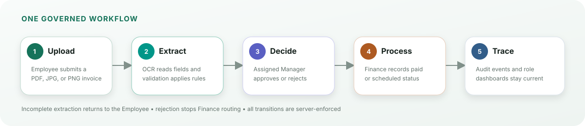
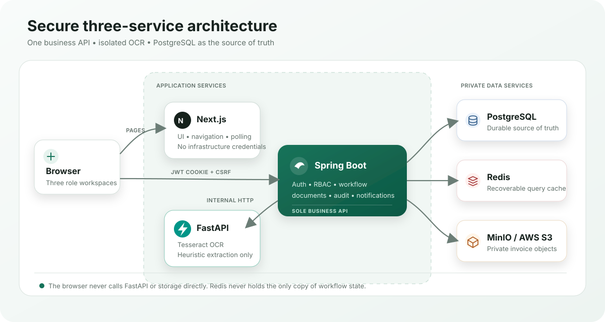

<div align="center">

# 🌐 Orbis Flow

### AI-assisted invoice approval, from upload to payment—with every handoff traceable.

[](https://nextjs.org/)
[](https://spring.io/projects/spring-boot)
[](https://fastapi.tiangolo.com/)
[](https://www.postgresql.org/)
[](https://redis.io/)
[](https://docs.docker.com/compose/)
[](https://github.com/ParthrChandurkar/orbisflow-platform/actions/workflows/ci.yml)

[Features](#-role-based-workflow) · [Architecture](#-architecture) · [Run locally](#-run-locally) · [Testing](#-testing) · [Documentation](#-design-documentation)

</div>

## 💡 What it solves

Orbis Flow replaces invoice handoffs scattered across email and spreadsheets with one accountable workflow for Employees, Managers, and Finance teams. It extracts structured invoice data with OCR, routes requests through controlled approval stages, and preserves the complete history of every material action.



| 3 fixed roles | 1 governed workflow | 3 application services | No cloud account required locally |
| :---: | :---: | :---: | :---: |
| Employee · Manager · Finance | Deliberate MVP scope | Next.js · Spring Boot · FastAPI | Docker Compose + MinIO |

## 🚦 Project status

| Area | Current state |
| --- | --- |
| Product | Full three-role backend and frontend implemented and tested |
| Local runtime | Complete workflow runs through Docker Compose, including private object storage |
| Production | AWS deployment is pending; the repository does not claim a live deployment |
| AI scope | Real Tesseract OCR with deterministic field extraction—not an LLM or hardcoded response |

## ✨ Role-based workflow

### 👩‍💻 Employee

- Upload PDF, JPG, or PNG invoices up to 10 MB with MIME, size, and file-signature validation.
- Review OCR-extracted vendor, invoice date, total, and line-item data.
- Correct flagged data, replace documents, retry extraction, and resubmit.
- Track only owned requests, document access, audit history, and notifications.

### 👔 Manager

- Review only requests routed to the assigned Manager.
- Inspect the source document, extracted data, and audit history.
- Approve eligible invoices or reject them with a mandatory reason.
- Monitor a paginated approval queue and scoped team-activity totals.

### 💼 Finance

- Review Manager-approved invoices in the Finance queue.
- Mark eligible invoices as `paid` or `scheduled`.
- View processed requests, payment details, documents, and audit history.
- Process any eligible Finance-stage request without a per-request Finance assignment.

## 🏗️ Architecture



The Next.js client calls one public business API: Spring Boot. Spring owns authentication, authorization, workflow transitions, PostgreSQL transactions, caching, and document access; it alone calls the internal FastAPI OCR service. This boundary prevents browsers from bypassing business rules or receiving database, object-store, or OCR-service credentials.

PostgreSQL is the durable source of truth. Redis contains only recoverable, scoped dashboard cache entries, while MinIO supplies private S3-compatible storage locally and AWS S3 is the production target. See the [architecture document](docs/architecture.md) for the full trust, file, and consistency model.

### Request lifecycle

1. An Employee uploads an invoice through Spring Boot; the validated file is stored under a non-guessable object key.
2. Spring invokes FastAPI in the background, where Tesseract performs OCR and deterministic parsing extracts vendor, date, total, and line items.
3. Complete, consistent data moves to `manager_review`; flagged data returns to `employee_review` for correction.
4. The assigned Manager approves or rejects. Approved requests move to `finance_review`.
5. Finance records `paid` or `scheduled`; every material transition appends an immutable audit event.

## 🧰 Tech stack

| Layer | Technologies |
| --- | --- |
| Frontend | Next.js 16.3.5, React 19, TypeScript, Tailwind CSS, shadcn/ui patterns, Lucide icons |
| Business API | Java 17, Spring Boot 3.5.4, Spring Security, JDBC, Flyway, JWT |
| OCR service | Python 3.11, FastAPI, Tesseract via pytesseract, Pillow, pypdfium2 |
| Data | PostgreSQL 17, Redis 7, MinIO locally, private AWS S3 in production |
| Delivery and QA | Docker, Docker Compose, GitHub Actions, Maven, Testcontainers, Vitest, Playwright, pytest, Ruff |

## 🛡️ Security and reliability

| Concern | Implemented decision | Why it matters |
| --- | --- | --- |
| Authentication | HS256 JWT delivered in a Secure, HttpOnly, SameSite cookie | Browser JavaScript cannot read the session token |
| Authorization | Deny-by-default role, ownership, assignment, and workflow-state checks | Hiding a UI control is never treated as access control |
| CSRF | HMAC-signed, subject-bound double-submit token on mutations | Automatically attached cookies alone cannot authorize forged actions |
| Documents | Private storage, file-signature validation, non-guessable keys, and 60-second access links | Files and storage credentials remain outside the client trust boundary |
| Consistency | PostgreSQL transactions and optimistic version checks | Concurrent approvals and payments cannot silently overwrite each other |
| Auditability | Append-only events and a database role without update/delete privileges | Current state cannot erase historical workflow evidence |
| OCR failure | Bounded internal call, persisted failure state, and explicit retry | A slow or failed extraction cannot duplicate the upload or corrupt workflow state |

## 🚀 Run locally

### Prerequisites

- [Git](https://git-scm.com/)
- [Docker Desktop](https://www.docker.com/products/docker-desktop/) or Docker Engine with the Compose plugin
- At least 6 GB of memory available to Docker for parallel image builds and OCR
- Ports `3000`, `5432`, `6379`, `8000`, `8080`, `9000`, and `9001` available

### 1. Clone and configure

```sh
git clone https://github.com/ParthrChandurkar/orbisflow-platform.git
cd orbisflow-platform
cp .env.example .env
```

On Windows PowerShell, replace the last command with:

```powershell
Copy-Item .env.example .env
```

No AWS account or external credentials are required. These defaults start a private MinIO bucket locally; populated `.env` files must never be committed.

### 2. Build and start

```sh
docker compose up --build -d
docker compose ps
```

### 3. Open and sign in

Open **[http://localhost:3000](http://localhost:3000)**. Supporting endpoints are:

- Spring Boot health: [http://localhost:8080/api/v1/health](http://localhost:8080/api/v1/health)
- FastAPI health: [http://localhost:8000/internal/v1/health](http://localhost:8000/internal/v1/health)
- MinIO console: [http://localhost:9001](http://localhost:9001)

Flyway creates the schema and local fixture accounts on the first clean start. The available `employee*`, `manager*`, and `finance*` usernames and shared development-only password are documented in [`V2__seed_test_users.sql`](backend/src/main/resources/db/migration/V2__seed_test_users.sql). Never reuse these credentials in a hosted environment.

View logs or stop the stack with:

```sh
docker compose logs -f
docker compose down
```

Use `docker compose down -v` only when you intentionally want to delete all local PostgreSQL, Redis, and MinIO data and rerun migrations from a clean state.

### Production configuration

The root [`.env.example`](.env.example) documents database, JWT, CSRF, service-port, Redis, and S3-compatible storage settings. A production deployment replaces the MinIO endpoint and development credentials with a private AWS S3 bucket and environment-provided secrets; application code does not change.

## 🧪 Testing

Run each suite from the repository root after installing its toolchain dependencies:

```sh
# Backend integration suite (Docker required for Testcontainers)
cd backend
mvn verify
cd ..

# AI service
cd ai-service
python -m pip install -e ".[dev]"
python -m pytest -q
python -m ruff check .
cd ..

# Frontend lint, unit, build, and browser suites
cd frontend
npm ci
npm run lint
npm test
npm run build
npm run test:e2e
```

The backend suite uses real PostgreSQL through Testcontainers and launches the OCR-service image for extraction paths. GitHub Actions independently verifies the frontend, backend, and AI service on pushes and pull requests to `main`.

## Project Status and Limitations

- Docker Compose provides the verified local workflow, including MinIO-based object storage.
- AWS-oriented S3 configuration is present, but this repository does not contain infrastructure-as-code for a complete AWS deployment.
- OCR output requires user review and correction.
- Local development credentials are fixtures, not production secrets.


